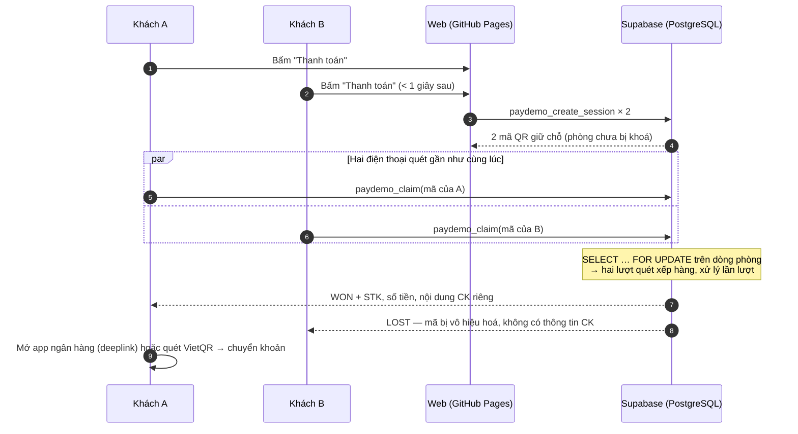

# Demo: phòng cuối cùng — chỉ 1 khách được chuyển khoản

Web thử nghiệm cơ chế thanh toán QR khi hệ thống chỉ còn **1 phòng**: hai khách bấm “Thanh toán”
gần như cùng lúc (cách nhau dưới 1 giây) và **cả hai đều nhận mã QR**. Khi quét mã, **chỉ người quét
trước** được chuyển đến bước chuyển khoản ngân hàng; người quét sau bị từ chối và không bao giờ
nhận được thông tin chuyển khoản.

| Trang | Dùng để |
|---|---|
| `index.html` | Khách đặt phòng → bấm “Thanh toán” → nhận **mã QR giữ chỗ** |
| `pay.html?s=…` | Trang mở ra khi khách quét mã → máy chủ quyết định thắng/thua |
| `demo.html` | Hai khách cạnh nhau, một nút để cả hai cùng bấm “Thanh toán” |
| `admin.html` | Chủ phòng: xác nhận đã nhận tiền, huỷ giữ phòng, reset, đổi cấu hình, **race test** |

## Vì sao không đưa thẳng mã VietQR của ngân hàng cho khách?

Mã VietQR (NAPAS 247) là dữ liệu tĩnh: app ngân hàng đọc trực tiếp số tài khoản từ mã, hệ thống
của bạn **không biết ai đã quét** và **không thể thu hồi** mã. Ai đang cầm mã đều chuyển khoản được.

Vì vậy mã đưa cho khách là **mã giữ chỗ**: một đường dẫn `pay.html?s=<mã phiên>` về hệ thống.
Khi khách quét, hệ thống chạy một thao tác khoá **nguyên tử** trong cơ sở dữ liệu. Chỉ người thắng
mới nhận mã VietQR thật (có sẵn số tiền và **nội dung chuyển khoản riêng** của phiên) cùng nút mở
app ngân hàng.



Trái tim của cơ chế nằm ở hàm `paydemo_claim` trong [`supabase/setup.sql`](supabase/setup.sql):

```sql
perform 1 from paydemo.rooms where id = v_room_id for update;   -- các lượt quét xếp hàng tại đây
...
if r.status = 'available' then  -- người đầu tiên: giữ phòng + trả thông tin chuyển khoản
else                            -- người đến sau: status = 'lost', không trả thông tin chuyển khoản
```

Một số chi tiết khác:

- **Thời gian giữ phòng** (mặc định 5 phút): người thắng không chuyển khoản kịp thì phòng tự mở lại.
- **Hiệu lực mã giữ chỗ** (mặc định 10 phút).
- Người thắng quét lại vẫn thắng (an toàn khi tải lại trang). Người thua quét lại vẫn bị từ chối.
- Bảng dữ liệu nằm trong schema `paydemo`, không lộ qua REST API. Trình duyệt chỉ gọi được các hàm
  `public.paydemo_*`. Mã phiên bí mật của người khác không bao giờ bị trả về.
- Bước quét mã giữ chỗ dùng **Camera điện thoại hoặc Zalo**, không dùng app ngân hàng (app ngân hàng
  chỉ đọc mã VietQR, không mở đường dẫn web).

## Cài đặt

### 1. Backend: Supabase (miễn phí)

GitHub Pages chỉ phục vụ file tĩnh, nên cần một cơ sở dữ liệu dùng chung để khoá phòng giữa các
điện thoại.

1. Vào <https://supabase.com/dashboard> → **New project** (Region: *Southeast Asia (Singapore)*).
   Giữ cấu hình Data API mặc định.
2. Mở **SQL Editor** → **New query** → dán toàn bộ [`supabase/setup.sql`](supabase/setup.sql) → **Run**.
   Nếu Supabase hiện cảnh báo, chọn chạy tiếp: script chỉ tạo đối tượng trong schema `paydemo` và
   các hàm `public.paydemo_*`.
3. Ô kết quả cuối cùng hiển thị **`MA_QUAN_TRI`**: lưu lại, dùng để đăng nhập `admin.html`.
   Quên mã thì chạy `select paydemo.init_admin_code(true);` để tạo mã mới.
4. Bấm **Connect** (hoặc Project Settings → API Keys) để lấy **Project URL** và **Publishable key**
   (`sb_publishable_…`; anon key dạng `eyJ…` cũng được).

Tài khoản nhận tiền, tên phòng và giá khởi tạo nằm ở mục 2 của `setup.sql`. Giá, thời gian giữ phòng
và hiệu lực mã QR đổi được ngay trên `admin.html`.

### 2. Cấu hình web

Điền hai giá trị vào [`config.js`](config.js):

```js
window.PAYDEMO_CONFIG = {
  supabaseUrl: 'https://xxxxxxxx.supabase.co',
  supabaseKey: 'sb_publishable_xxxxxxxx',
  roomId: 'P101',
  pollMs: 1000
};
```

Hai giá trị này được thiết kế để công khai: quyền truy cập đã bị khoá bằng RLS và các hàm
`SECURITY DEFINER`.

### 3. GitHub Pages

Repo → **Settings → Pages** → *Build and deployment*: **Deploy from a branch**, branch `main`,
thư mục `/ (root)` → **Save**. Sau khoảng 1 phút web chạy tại `https://<tài-khoản>.github.io/<tên-repo>/`.

## Kịch bản thử nghiệm

1. `admin.html` → đăng nhập → **Reset demo** (phòng về trạng thái “Còn 1 phòng”).
2. `demo.html` → bấm **⚡ Cả 2 khách cùng bấm “Thanh toán”**: hai mã QR giữ chỗ xuất hiện.
3. Điện thoại 1 quét mã Khách A, điện thoại 2 quét mã Khách B, gần như cùng lúc.
4. Điện thoại quét trước hiện **“Bạn là người đầu tiên!”**, kèm nút mở app ngân hàng (5 app tự điền
   sẵn: VietinBank, BIDV, OCB, ACB, MB), ảnh VietQR để lưu và quét từ thư viện, và nút sao chép
   STK/số tiền/nội dung. Khung khách tương ứng trên máy tính đổi sang mã VietQR chuyển khoản.
5. Điện thoại quét sau hiện **“Giao dịch không thể tiếp tục”**, không có thông tin chuyển khoản.
6. Chuyển khoản thật (số tiền nhỏ) → bấm “Tôi đã chuyển khoản” → trên `admin.html` bấm
   **Xác nhận đã nhận tiền** → phòng chuyển sang “Đã bán”.
7. **Race test** trên `admin.html` bắn tới 50 lượt quét đồng thời lên Supabase thật. Kết quả đúng:
   luôn **1 người thắng**, mọi người còn lại bị từ chối.

## Giới hạn của bản demo và hướng đưa lên production

- **Ngân hàng không chặn được tiền chuyển đến một tài khoản tĩnh.** Cơ chế này đảm bảo chỉ người
  thắng *nhận được* hướng dẫn chuyển khoản. Nếu ai đó vẫn tự chuyển tiền (vì đã biết STK), giao dịch
  vẫn thành công ở phía ngân hàng. Nội dung chuyển khoản riêng cho từng phiên giúp nhận diện và hoàn
  tiền. Muốn ngân hàng từ chối thẳng, cần **tài khoản định danh (virtual account) theo từng đơn**,
  đóng lại khi hết hạn.
- **Xác nhận đã nhận tiền đang làm thủ công** trên `admin.html`. Production nên tự động đối soát bằng
  webhook giao dịch ngân hàng (ví dụ các dịch vụ PayOS, SePay, Casso) khớp theo nội dung chuyển khoản.
- Deeplink app ngân hàng dùng dịch vụ `dl.vietqr.io`. Chỉ 5 app hỗ trợ tự điền, các app khác chỉ
  được mở lên.
- Trang quản trị bảo vệ bằng mã 8 ký tự, đủ cho demo nhưng không thay thế được đăng nhập thật.

## Cấu trúc

```
├── index.html, pay.html, demo.html, admin.html
├── config.js                 ← URL + publishable key của Supabase
├── assets/
│   ├── common.js             ← gọi API, VietQR (EMVCo + CRC16), deeplink, vẽ QR
│   ├── checkout.js, pay.js, demo.js, admin.js
│   ├── bank-apps.js          ← danh sách app ngân hàng hỗ trợ deeplink (api.vietqr.io)
│   ├── style.css
│   └── vendor/qrcode.js      ← qrcode-generator (MIT, Kazuhiko Arase)
└── supabase/setup.sql        ← bảng, hàm khoá nguyên tử, phân quyền, mã quản trị
```
